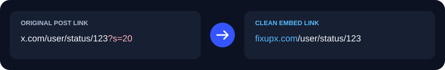

<p align="center">
  
</p>
<h1 align="center">Linklift</h1>
<p align="center">Clean embed links and media downloads for Chrome and Firefox.</p>
<p align="center">
  <a href="https://github.com/mhhassaan/Linklift/releases/latest">Download</a> ·
  <a href="PRIVACY.md">Privacy Policy</a> ·
  <a href="TERMS.md">Terms of Use</a> ·
  <a href="https://github.com/mhhassaan/Linklift/issues">Report an issue</a>
</p>



## What it does

- **Better sharing:** rewrites the post's **Copy link** result to your chosen embed service and removes tracking.
- **Media downloads:** saves the best available quality, with a dropdown for media, quality and save-location choices.
- **Real GIFs:** converts MP4-backed GIF posts inside the browser; no intermediate MP4 is saved.
- **Your preferences:** one dashboard for custom services, per-site link rewriting and download-button visibility.

| Platform | Included embed services | Media tools |
| :--- | :--- | :--- |
| **X / Twitter** | `fixupx.com` · `fxtwitter.com` | Post downloads; right-click to copy or download photos |
| **Instagram** | `zzinstagram.com` · `ddinstagram.com` | Open posts, reels and carousels |
| **Reddit** | `vxreddit.com` · `rxddit.com` | Videos with audio; current-image or all-image gallery downloads |
| **TikTok** | `tfxktok.com` · `tnktok.com` | Videos and photo posts; video downloads use the open page's session |

## Install

**[Download the latest release](https://github.com/mhhassaan/Linklift/releases/latest)** and extract the ZIP for your browser.

| Browser | Steps |
| :--- | :--- |
| **Chrome 121+** | Open `chrome://extensions` → enable **Developer mode** → **Load unpacked** → select the extracted folder. |
| **Firefox 128+** | Open `about:debugging#/runtime/this-firefox` → **Load Temporary Add-on** → select the extracted `manifest.json`. |

Refresh supported tabs after installing or updating. Approve added site access if prompted. Firefox ZIPs are unsigned temporary add-ons; persistent installation requires signing.

## Use

1. **Share:** open a post's Share menu and choose **Copy link**. Opening Share alone leaves your clipboard unchanged.
2. **Download:** click the download button beside the post actions. Use its dropdown for choices; Reddit galleries offer **this image** or **all images**.
3. **Customize:** open the toolbar popup or **Dashboard**. Turn rewriting off for any site to copy its original links.

No analytics. Settings stay local, and conversion runs in your browser. **[Privacy and permissions →](PRIVACY.md)**

<details>
<summary><strong>Limits and troubleshooting</strong></summary>

- Availability depends on the website and selected embed service. Private, expired, encrypted, live and unsupported streams may be unavailable.
- If TikTok says media is not available yet, play the video or reopen the post and retry.
- Local processing and TikTok transfers support files up to **256 MiB**. GIF conversion supports up to **60 seconds**; use a smaller preset if needed.
- Incomplete downloads expire after **five minutes**. Keep the originating tab open until the download finishes.

</details>

<details>
<summary><strong>Build from source</strong></summary>

Use **Node.js 24.15.0+ (24.x)** and npm:

```sh
npm ci
npm run build
```

Load `dist/chrome/` or `dist/firefox/manifest.json` using the steps above. On PowerShell, use `npm.cmd` if the script launcher is restricted. Run `npm run check` to build and verify both packages.

</details>

[Third-party credits and licenses](THIRD_PARTY_NOTICES.md) · [Privacy Policy](PRIVACY.md) · [Terms of Use](TERMS.md)
