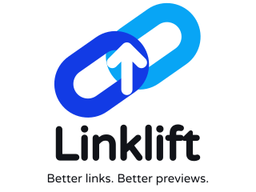

<p align="center">
  
</p>
<h1 align="center">Linklift</h1>

Linklift is a browser extension for Chrome and Firefox that copies clean embed links and adds media download controls to posts on X (Twitter), Instagram, Reddit, and TikTok. It also adds photo copying on X.

## Features

- Copy a clean proxy link when choosing **Copy link** in a post's Share menu. Opening Share alone does not change the clipboard.
- Remove tracking parameters and URL fragments from copied post links.
- Choose an embed service or add a custom domain independently for each platform.
- Enable or disable link rewriting separately for each website to copy its original links whenever preferred.
- Manage all platforms together in a single dashboard, accessible from the popup's **Dashboard** button or the extension's options page.
- Copy or download an X still photo from the browser's **Linklift** context menu.
- Download recognized photos, videos and GIFs using a button beside post media. A normal click chooses the best available source; the adjacent dropdown offers quality, format and save-location choices.
- Save GIF posts as actual `.gif` files, including browser-local conversion of MP4-backed animations. No intermediate MP4 is saved to your Downloads folder.
- Download the current image or every image from a Reddit gallery using one post-level control.
- Hide download buttons independently for each website without changing its link preferences.
- Keep settings locally without analytics or remote tracking.

Example:

```text
https://x.com/username/status/1234567890?s=20
                         ↓
https://fixupx.com/username/status/1234567890
```

## Requirements

- Desktop Chrome 121+ or Firefox 128+.
- Node.js 24, version 24.15.0 or newer, and npm to build from source.

The recommended Node.js version is recorded in `.node-version`.

## Build

```sh
npm ci
npm run build
```

The build produces `dist/chrome/` and `dist/firefox/`.

On Windows PowerShell, use `npm.cmd` if the `npm` script launcher is restricted.

## Installation

Download the Chrome or Firefox ZIP from [GitHub Releases](https://github.com/mhhassaan/Linklift/releases/latest) and extract it first. Each ZIP contains `manifest.json` at its root. You can also build the extension from source using the steps above.

### Chrome

1. Open `chrome://extensions` and enable **Developer mode**.
2. Select **Load unpacked** and choose the extracted Chrome package directory, or `dist/chrome/` if building from source.
3. Refresh any open supported social-media tabs. When upgrading, approve the added site access if prompted.

### Firefox

1. Open `about:debugging#/runtime/this-firefox`.
2. Select **Load Temporary Add-on** and choose `manifest.json` in the extracted Firefox package, or `dist/firefox/manifest.json` if building from source.
3. Allow the requested site access and refresh any open supported social-media tabs.

Temporary Firefox add-ons must be loaded again after restarting the browser. Persistent distribution requires a signed add-on.

After rebuilding, reload the extension in the browser's extension manager and refresh supported social-media tabs.

## Usage

### Share a post

Use the post's existing **Copy link** action, usually inside its Share menu. Linklift changes a recognized post URL to the selected proxy and removes tracking. Opening Share alone does not change the clipboard. X keeps Linklift's copy confirmation; the other platforms retain their own menu and copy feedback.

| Platform | Supported links | Default service | Included alternative |
| --- | --- | --- | --- |
| X / Twitter | Posts | `fixupx.com` | `fxtwitter.com` |
| Instagram | Posts, reels, carousel images | `zzinstagram.com` | `ddinstagram.com` |
| Reddit | Posts and comment permalinks | `vxreddit.com` | `rxddit.com` |
| TikTok | Videos and photo posts | `tfxktok.com` | `tnktok.com` |

Instagram carousel image selection (`img_index`) is preserved. Profile, feed, and unrecognized links retain their original copying behavior. Opaque short links are left unchanged unless the originating Reddit post supplies its canonical permalink.

On X, if copying fails, use the displayed original link or select **Use original Share**, reopen the post's Share menu, and choose **Copy link** again to use X's original copying behavior once. Other platforms retain their native error handling.

### Copy or download a photo

On X, right-click a photo and select **Linklift → Copy image** or **Linklift → Download image**. Linklift tries the original-size image first and falls back to the displayed rendition if necessary.

### Download post media

Use the download icon in X's post action row, **Download** next to Reddit's Share button, or the download control beside the actions on an open Instagram/TikTok post or reel. A normal click saves the best available rendition. Instagram profile-grid covers are not treated as downloadable post media; open the post or reel first. Controls on Instagram and TikTok are positioned outside the native player layout.

Instagram uses an outlined icon beside Send in horizontal post actions and a vertical action on reels. TikTok uses a circular button with a filled download icon in its action rail. Download progress and Cancel appear in a separate toast, clear of the post buttons.

Each post has one download control. On Reddit image galleries, clicking **Download** offers **Download this image** for the currently visible slide or **Download all images**. All images download one at a time; cancelling or a failed file stops the remaining queue. For other galleries, open the dropdown and use **Media** to choose an image or video, then choose the available quality, format and save location. Repeated background/preview layers do not get their own buttons. Instagram comment media is excluded from the post's downloads.

Original Instagram MP4 videos transfer directly through the browser's download manager. TikTok videos are fetched within the open page's normal session, validated as MP4, and saved from a temporary local file. TikTok's quality selector chooses the source rendition; its output is MP4. MP4 remuxing on other supported platforms preserves the existing video encoding; it does not increase its quality. Available choices depend on what the website exposes. Download feedback tracks the browser's actual completion event, briefly shows **Downloaded**, then disappears.

GIF posts always save as GIF. MP4-backed animations are converted inside the browser, with full-size, 720px and 480px presets. If full-size conversion exceeds processing limits, choose a smaller preset. Conversion errors never silently save an MP4 instead. Use **Cancel** to stop an active fetch or conversion. Temporary source data and conversion URLs are discarded after success, failure or cancellation; only the final file is offered for saving.

Reddit video quality choices are loaded from the post's media manifest, and separate video/audio tracks are joined locally. Reddit's embedded player metadata is used when available, including its newer player layout. If media has not been discovered yet, play the video or reopen the post. A Reddit post may need to load its public post metadata when you use a download control; an unresolved Instagram or TikTok video may load its post page metadata. Video posters are resolved to their underlying video instead of being saved as images. Media that cannot be resolved shows an error instead of saving a thumbnail or an unclassified animation.

Use **Show media download buttons** in each platform's popup or dashboard card to hide these controls for that site. This setting is independent of link rewriting and X's existing context-menu photo tools.

### Configure an embed service

Open the Linklift toolbar popup to add, select, or remove a service for the active platform. Use the platform buttons to switch sites, or open **Dashboard** to see every platform at once. Changes apply to the next copied link without refreshing the site.

Use the **On / Off** switch beside each platform's heading to toggle link rewriting. When off, the site's Copy link action copies its original URL, including any parameters the site supplies. Your selected proxy stays saved for when you turn rewriting back on. Changes apply to open tabs without a refresh. Turning off X link rewriting leaves its photo tools available.

Accepted entries include `fixupx`, `fxtwitter`, and full HTTPS domains such as `example.com`. A service must support that platform's original post path; custom URL paths and templates are not supported.

The bundled choices are documented by [InstaEmbedRouter](https://github.com/Knoppiix/InstaEmbedRouter), [InstaFix](https://github.com/Wikidepia/InstaFix), [vxReddit](https://github.com/dylanpdx/vxReddit), [FixReddit](https://github.com/MinnDevelopment/fxreddit), [FxTikTok](https://tfxktok.com/), and [fxTikTok](https://github.com/okdargy/fxTikTok). These are independent third-party services; inclusion does not guarantee uptime or embed compatibility. The original InstaFix repository is archived.

## Privacy and permissions

Linklift stores service preferences in local extension storage. It does not collect analytics, read clipboard contents, or send post links to a proxy when copying them.

The extension requests access to supported X/Twitter, Instagram, Reddit, and TikTok pages and their supported media CDN domains, plus permissions for clipboard writing, context menus, downloads, and storage. Chrome also uses an offscreen document for local media processing. New media permissions may need approval when upgrading.

Linklift observes media metadata already loaded by supported pages to identify post media and available qualities. It keeps a bounded media URL cache in the current page, without storing response bodies or account information. Media bytes are fetched only after a download/photo action, and manifests may be fetched when opening quality choices. CDN requests made by the local processing helper omit cookies. TikTok video requests use the page's normal session and remain subject to browser cookie and cross-origin policies; Linklift does not read cookies. Direct Instagram MP4 downloads and X's existing photo-copy tool use the browser's normal request policies. Conversion and audio/video joining happen inside the browser; no media is sent to a conversion server.

Media data is held temporarily for copying or downloading. Download association metadata is kept in session storage and cleaned up when work finishes. Copied clipboard content and saved files remain under user control.

## Limitations

- Media downloading depends on recognized post layouts, available metadata and supported CDN hosts. Private, expired, encrypted, live, segmented HLS and otherwise unsupported streams may be unavailable. Protected content is not bypassed.
- TikTok loads media dynamically. If a video reports **Media is not available yet**, play it or reopen the post, then retry the download.
- Local media processing and TikTok page transfers are limited to 256 MiB per file. Processing output is also limited to 256 MiB. One file is processed at a time, with at most two retained output files. Direct Instagram MP4 transfers use the browser's download manager without buffering the file in the processing helper. Existing X context-menu photo tools retain their 32 MiB / 48 million decoded pixel limits.
- Local GIF conversion supports up to 60 seconds, 900 frames and 100 million total frame pixels. Full-size conversion samples at up to 15 fps; smaller presets use 10 or 8 fps. GIF's 256-color palette can reduce color fidelity compared with the source video.
- Incomplete or paused downloads expire after five minutes. Closing or navigating the originating tab can cancel unfinished processing or downloads.
- Embed availability depends on the selected proxy and destination platform.
- Native Copy link detection currently recognizes English labels and supported site control identifiers. Other languages or interface changes can leave a link unchanged.
- Site changes may affect post, copy-action, photo, or light/dark theme detection. Unrecognized controls retain native behavior.

## Asset credits

[Varela Round](https://github.com/google/fonts/tree/main/ofl/varelaround) is distributed under the SIL Open Font License. Interface icons come from [Google Material Design Icons](https://github.com/google/material-design-icons) under Apache 2.0. Platform logo vectors come from [Simple Icons](https://github.com/simple-icons/simple-icons) under CC0; platform names and logos belong to their respective owners. Asset licenses are included in both browser packages.

Local GIF encoding uses [gifenc](https://github.com/mattdesl/gifenc) under MIT. Video/audio remuxing uses [Mediabunny](https://github.com/Vanilagy/mediabunny) under MPL 2.0. Both packages include license notices and a corresponding-source link in `licenses/`.
